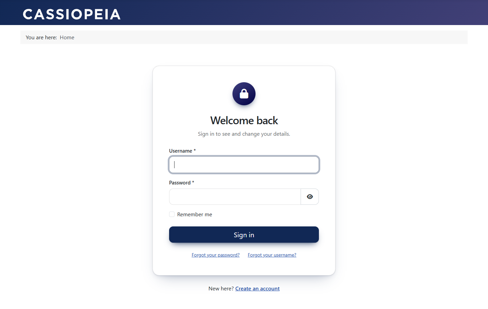
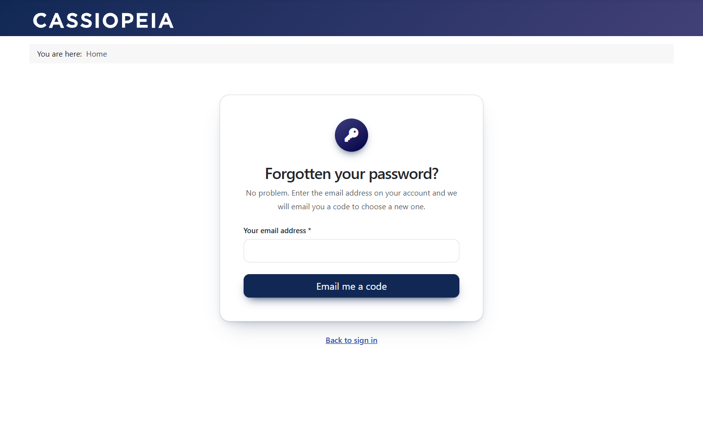
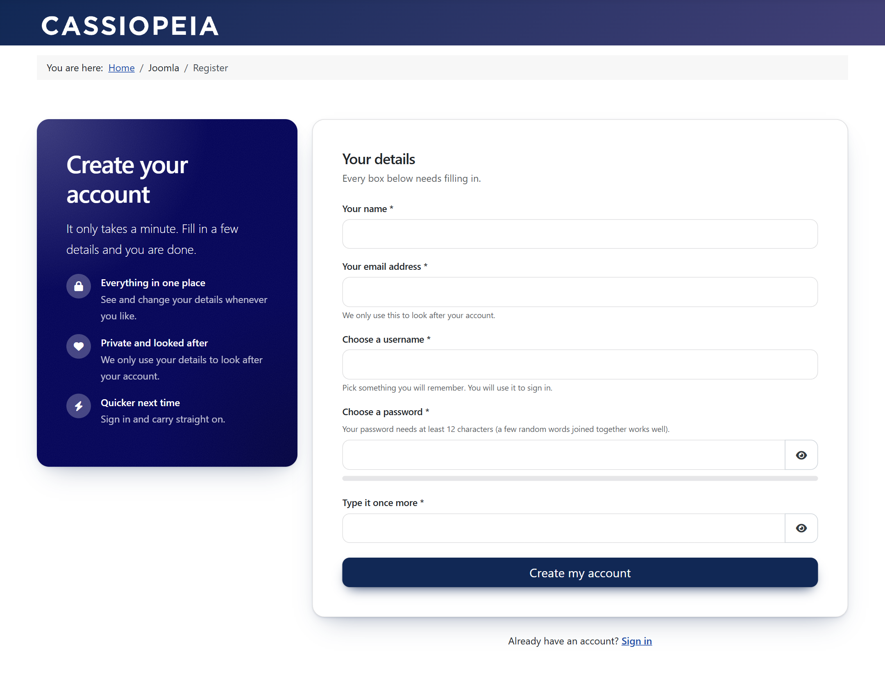
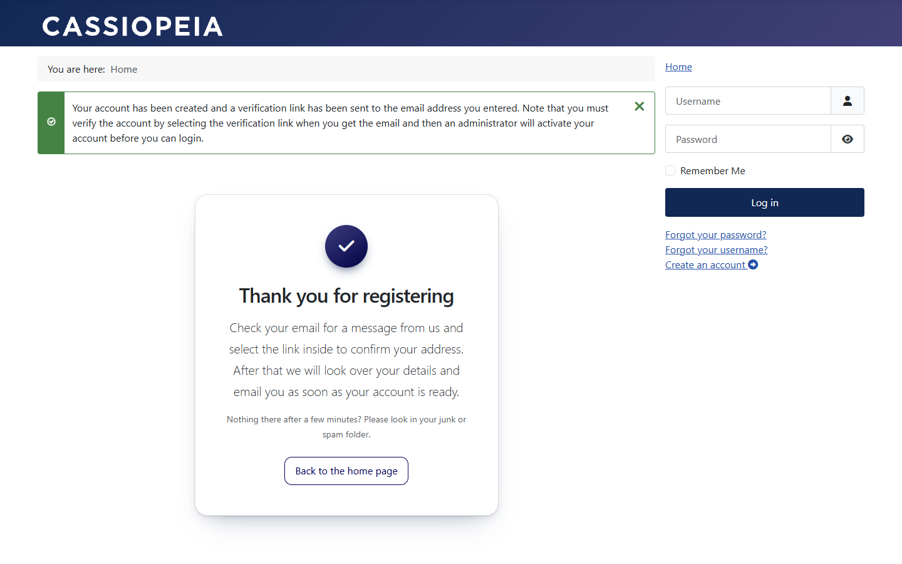
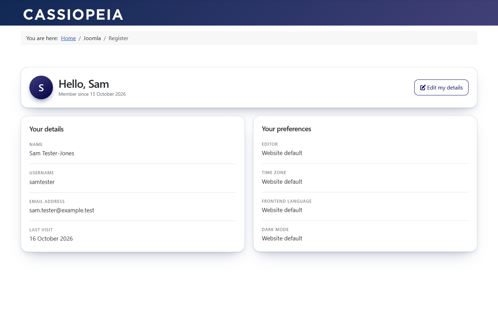
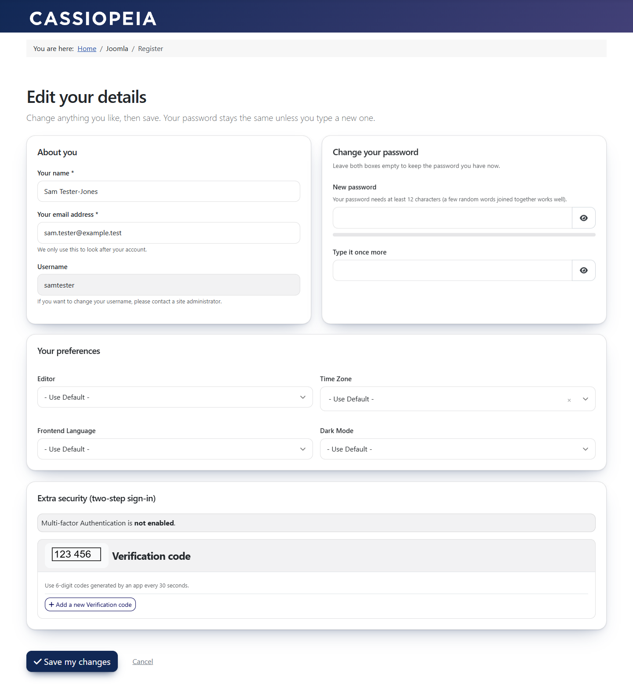
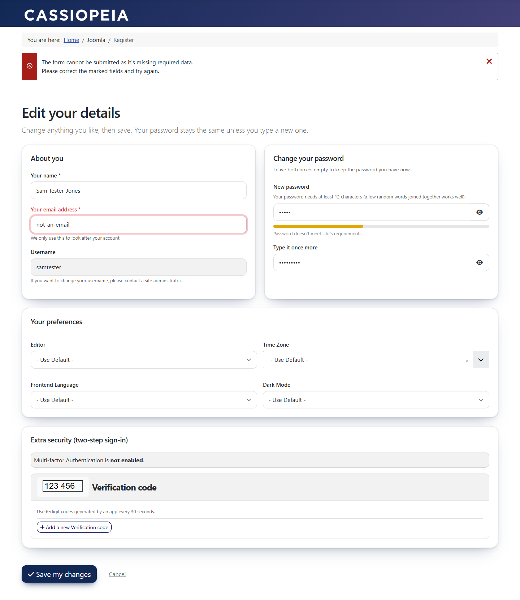

# Friendly Account Pages for Joomla

Joomla's built-in sign-in, registration and profile screens work, but they read like forms from 2012: one long column, "User Registration", "Minimum Requirements — Characters: 12". This is a drop-in set of **template overrides** that turns them into warm, rounded, card-based pages in plain English, using **only the Bootstrap 5 that Joomla already ships**. No extra library, no JavaScript, no plugin, no database change.

Version 1.1.1. For **Joomla 5 and 6** (tested on 5.2.6, 5.4.10 and 6.2.0). GPL-2.0-or-later. **[Install guide](INSTALL.md)** · [Changelog](CHANGELOG.md) · [Report a problem](https://github.com/dmlwebal/joomla-friendly-account-pages/issues)

| Sign in | Forgotten password |
|---|---|
|  |  |

| Register | Thank you |
|---|---|
|  |  |

| My profile | Edit profile |
|---|---|
|  |  |

| Edit profile with a rejected field |
|---|
|  |

Screenshots are stock Cassiopeia, untouched: the colours and fonts are the template's own.

## What you get

- **Sign in:** a centred card with "Welcome back", a lock badge, the remember-me option, "Forgot your password?" and "Forgot your username?" links, and "New here? Create an account" when registration is on. Passkey and other extra sign-in buttons that plugins add are kept. A matching **sign-out** card says "Ready to sign out?".
- **Forgotten password:** all three steps in the same style: "Forgotten your password?" (ask for the email address), "Check your email" (enter the username and the code) and "Choose a new password". **Forgotten username** gets the same treatment.
- **Register:** a welcome panel (heading, a warm line, three reasons to join) beside a form card, with "Already have an account? Sign in". Plain labels and hints: "Your email address", "Choose a password", "Type it once more", "Create my account".
- **Thank you:** Joomla prints only a flash message here. This adds a heading and a clear next step that matches your activation setting (email link, or email link then admin approval).
- **My profile:** a greeting card with the member's initial, "Member since…" and an Edit button, then "Your details" and "Your preferences" cards.
- **Edit your details:** "About you", "Change your password", "Your preferences" and "Extra security" cards, then Save and Cancel. A field Joomla rejects turns red, with its label, so people can see what to fix. The select boxes, including the time-zone box, share one plain look.

It follows the site, so there is nothing to configure:

- **Fonts:** none are set. Everything uses the template's own typography.
- **Colours:** the coloured parts (welcome panel, avatar, buttons) are painted by the template's own Bootstrap classes (`bg-primary`, `btn-primary`). The soft tints (shadows, focus ring) look for the template's primary colour and fall back to neutral grey.
- **Light and dark:** borders and muted text are taken from the current text colour, so they follow a colour scheme when the template has one.
- **Rounded:** cards, fields, buttons and badges, with a short rise-in that is switched off for people who ask for reduced motion.

## What stays Joomla's

Joomla's own field rendering, validation script, task names, hidden fields, captcha, multi-factor panel and flash messages are all kept. Registering and saving a profile work exactly as before. Only the markup around them changes.

## Who sees "Your preferences"

The preferences card (editor, time zone, language, dark mode) is shown **only to people who may log in to the administrator**: by default Manager, Administrator and Super User. For those users it carries a short caution ("Leave these on the default unless you really need to change them") and also lists the staff-only settings Joomla adds for them (backend template style, backend language, auto-starting tours). Everyone else sees neither the card nor the fields, so they simply get the site defaults, and anything already saved on their account is left untouched when they save their profile.

The rule is one line in `com_users/profile/default_params.php` and `com_users/profile/edit.php` (`core.login.admin`), so it follows the site's own permissions (System > Global Configuration > Permissions). Change that permission name to use a different rule, or delete the check to show the card to everyone.

## Install (about five minutes)

Copy the kit's **`html`** folder into `templates/<your template>/`, make sure the registration and profile menu items exist, and you are done: the stylesheet and the wording travel inside the kit. The full step-by-step guide, with how to remove it and a troubleshooting table, is in **[INSTALL.md](INSTALL.md)**.

## Make it yours

- **Wording:** open **System > Language Overrides** (Site, English) and search for `TPL_ACCOUNT_`. Your edits win over the kit's wording and survive kit updates. The three "reasons to join" are placeholders, so rewrite them for the site.
- **Another language:** copy `html/account-pages/language/en-GB` to the new language code, rename the file to `<code>.account_pages.ini` and translate the values. Missing lines fall back to English.
- **Pin a colour for the tints:** set `--acct-accent-override: #0a7d5a;` on `.acct` in your own CSS.

## Decisions worth knowing

- **One `<h1>` per page.** Each override prints its own heading and ignores the menu item's "Show page heading" option, so a page never gets two.
- **Icons use Joomla's own icon font (`icon-*`)**, which is already on the page. If a template does not load it the icons simply do not show; nothing breaks.
- **The username field stays.** Joomla requires one. Using the email as the username would need an extra plugin.
- **The stylesheet is loaded through Joomla's web asset manager** (with a version stamp), from the kit's own folder.
- **Joomla will tell you when core changes.** After an update, System > Site Templates (your template) lists any override whose original file has changed. That is the cue to compare the files; the notes at the top of each override say what was changed.

## Compatibility

| | Joomla 5.0 and 5.1 | Joomla 5.2 | Joomla 5.3 and 5.4 | Joomla 6.x |
|---|---|---|---|---|
| Supported | Yes | Yes | Yes | Yes |
| Tested | No (see note) | **5.2.6** | **5.4.10** | **6.2.0** (6.1.4 by hand) |

- **Joomla:** version 5.0 and later, and 6.x. The 1.1.1 release fixes a 500 error that version 1.1.0 gave on Joomla 5.0 to 5.2 (`Form::renderControlFields()` only exists from Joomla 5.3). Version 1.1.0 should only be used on Joomla 5.3 or later; use 1.1.1 or later everywhere.
- **Joomla 5.0 and 5.1 were not run.** They should work: the overrides use only methods that exist in Joomla 5.0.0 (checked in the Joomla source), and the same code path is exercised on 5.2.6. If you try one, please tell us.
- **Joomla 4 is not a target.** The pages use classes from Bootstrap 5.2 and 5.3 (`text-bg-primary`, `text-body-secondary`) and Joomla 4's template and view code differs. It has not been tested.
- **PHP:** whatever your Joomla needs (PHP 8.1 or later for Joomla 5, PHP 8.3 or later for Joomla 6). The overrides use nothing newer than PHP 8.0 (`str_contains`). They were tested on PHP 8.4.
- **Template:** Cassiopeia (and child templates of it) and any template built on Bootstrap 5. Only stock Cassiopeia has been tested.

## Tested

Version 1.1.1 was installed from the kit's `html` folder on fresh **Joomla 5.2.6**, **5.4.10** and **6.2.0** sites with stock Cassiopeia, and each was run through the same **55 checks** in a real browser (desktop 1440 px and mobile 375 px), as described below. On 5.2.6 the 1.1.0 files give a 500 error on every page that was tried (register, sign in, forgotten password, forgotten username) and the 1.1.1 files do not. Earlier releases were tested on 5.4.10 and 6.2.0 with a 59-check run; it was also tried by hand on Joomla 6.1.4 while building.

- **Register and thank-you:** the page renders with its stylesheet, an empty submit is blocked and the fields flagged, a taken username shows Joomla's own error and keeps what was typed, and a valid sign-up creates the account and reaches the thank-you page.
- **Profile and edit profile** as a Registered user, a Manager and a Super User: the "Your preferences" card is hidden for Registered and shown for the other two; a rejected email field turns red; saving shows "Profile saved" and Cancel returns to the profile.
- **Sign in and sign out:** a wrong password shows Joomla's message and the friendly form again, the right password signs in, and the sign-out card signs out.
- **Forgotten password, start to finish:** an empty request is blocked; with a code set directly in the database (the test machine cannot send email), the "Check your email" step accepts it, "Choose a new password" saves the new password, and signing in with it works. **Forgotten username** submits without error.
- **Every page:** one `<main>`, one `<h1>`, headings in order inside the page, no raw wording keys, no PHP notices, no JavaScript errors or failed requests, and no sideways scroll at 375 px.

Checked by hand on 6.1.4 only: saving the profile as a Registered user leaves their stored time zone and language untouched.

**Not tested:** other templates, captcha, passkey or other extra sign-in buttons (the kit keeps them, but no such plugin was installed), the User - Profile plugin's extra fields, a real dark colour scheme (Cassiopeia has none), right-to-left languages, and languages other than English.

## Not included

The wording of Joomla's own emails (activation, password reset and username reminder).

## Licence and credit

GNU General Public License version 2 or later, the same as Joomla (see `LICENSE`). Built with AI assistance (Claude, by Anthropic) and tested as described above.

Friendly Account Pages is an independent project. It is not affiliated with or endorsed by the Joomla Project or Open Source Matters, Inc. Joomla® is a registered trademark of Open Source Matters, Inc.
